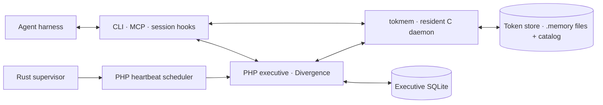

# Navi-Brain

Navi-Brain is Navi's persistent memory and executive runtime. It carries
memories, intentions, action history, and an evidence-backed self-model across
conversations, agent harnesses, and model changes.

At its center is **tokmem**, a resident C daemon with its own lossless tokenizer,
memory format, and associative recall graph. The PHP executive coordinates
intentions, decisions, working memory, and background work through Divergence
and a separate SQLite database. A Rust supervisor supports heartbeat recovery;
Python utilities handle verified backup, restore, and store rebuilding.

The organizing idea is that cognitive state should outlive any individual model
invocation. A model receives selected context, contributes a transition or
proposal, and leaves behind state that the next interaction can continue from.

## Architecture



The two stores have different responsibilities:

| Store | Default location | Owns |
| --- | --- | --- |
| Token memory | `memories/store/` | Memory content, metadata, token identities, associations, learned counters, and operation receipts. |
| Executive state | `var/navi-brain.sqlite` | Intentions, actions, decisions, evidence, working-memory bookkeeping, schedules, leases, and recovery journals. |

The memory daemon serves clients over a Unix-domain socket using the `TOKMEM/1`
protocol. Memory CLI and MCP calls can reach it without initializing the PHP
executive. The C executable also has its own client, so the memory engine can
run independently of PHP.

## The memory engine

tokmem owns the complete path from incoming prose to stored tokens and recalled
context:

- **A vocabulary that grows with the store.** Token identities start with the
  256 byte values. Repeated adjacent sequences form larger tokens online while
  preserving exact input bytes. These identities belong to the memory store,
  independently of whichever model is reasoning over its output.
- **Resident recall state.** The token registry, prefix trie, content postings,
  directed associations, and learned counters stay in RAM across requests.
  Recall uses token matches, sequence coverage, and bounded association
  traversal without an inference call.
- **Separate learning signals.** Writes, delivered reads, and cue usage have
  independent counters. Traversed associations acquire directional
  reinforcement. Verification and mechanical import stay counter-neutral.
- **Explicit persistence.** Each record contains `content.memory`,
  `metadata.memory`, and a SHA-256 manifest. Publication uses staged writes,
  filesystem synchronization, and atomic directory operations. The store's
  SQLite catalog holds token translations, accounting, and recovery state.
- **Content and bookkeeping stay separate.** Metadata does not seed recall
  postings or associations. Agent-facing memory reads return prose; storage
  IDs, ranking scores, and record envelopes remain internal.

### Writing memory

Submit UTF-8 prose on standard input:

```sh
printf '%s\n' 'The build needed the SQLite development headers.' \
  | ./bin/navi-memory-write
```

The writer hands the request to the daemon and closes silently. The daemon
serializes mutations through a dedicated FIFO writer and supplies storage
metadata internally. Identical prose submissions use the same content-derived
operation key.

This is asynchronous submission: a successful send is not a disk-persistence
receipt, and an immediate recall can race the writer. Pending writes remain in
RAM until committed. The same interface is available as
`php bin/navi-brain memory:add --content='…'`.

### Two ways to recall

| Purpose | CLI | MCP |
| --- | --- | --- |
| Look up a particular remembered fact or episode. | `memory:search --query=… --limit=…` | `remember_navi` with `thoughts` and `limit` |
| Bring relevant context into the current task under a token budget. | `status --active-intention=… --token-budget=…`, or `recall --query=… --token-budget=…` | `brain_status` with `active_intention` and `token_budget` |

Explicit search retrieves candidate records from the daemon and orders them by
keyword coverage in the PHP adapter. Activation selects a cohort of active
working, semantic, or procedural traces from the resident graph. Raw episodic
captures remain available through explicit search.

Activation budgets count **the store's own tokens**, including separators.
They are distinct from a language model's context-token accounting.

```sh
php bin/navi-brain memory:search \
  --query='SQLite development headers' --limit=5

php bin/navi-brain status \
  --active-intention='Continue work on the memory daemon' --token-budget=1024
```

The native client can perform activation directly against a running daemon:

```sh
printf '%s' 'Continue work on the memory daemon' \
  | ./memories/build/tokmem client ./memories/store/tokmem.sock activate - 1024
```

See the [memory guide](memories/README.md) for storage and client operations,
and the [architecture specification](memories/ARCHITECTURE.md) for tokenizer,
ranking, accounting, and persistence details.

## The executive

The [PHP executive](src/Core/ExecutiveCore/) maintains the state surrounding
memory and model calls:

- Intentions with authority, next actions, success conditions, and release
  conditions.
- Working-memory projections tied to backing records and recoverable update
  journals.
- Decision cycles, candidate actions, observed outcomes, and reusable
  procedures bound to installed adapters.
- Evidence-backed self-model facts, values, needs, and appraisal state.
- Scheduled work, worker ownership, fencing tokens, and recovery of abandoned
  operations.

Model results enter through validation and integration paths. Current user
instructions govern action; remembered intentions and generated proposals do
not grant additional permissions. Synthetic thoughts retain their provenance
instead of silently becoming factual memories.

## Getting started

Run the examples from the repository root on Linux. The full application needs:

- A C17 compiler, Make, SQLite development headers, and pthreads for tokmem.
- PHP 8.1 or newer with PDO/SQLite support, plus Composer.
- A local Divergence framework checkout at `../../Divergence/framework`, as
  configured in [composer.json](composer.json). Composer symlinks this path
  dependency.

Python 3 is used by the backup and rebuild utilities. Rust/Cargo is needed only
when building the optional heartbeat supervisor. Memory storage and recall
require no model service.

For a **new checkout with no existing state**:

```sh
cp .env.example .env
composer install
make -C memories
./memories/build/tokmem init ./memories/store
php bin/navi-brain init
php bin/navi-brain recall:init
```

`init` creates the executive schema and operational defaults. `recall:init`
connects to the memory daemon or starts it under a guarded startup lock.
Subsequent clients share the resident process. To run the engine directly in
the foreground, use `./memories/build/tokmem daemon STORE` with an initialized
store that has no daemon already running.

A clone contains the implementation and research material. Personal memories,
learned narratives, captured sessions, and the local configuration belong to
the running installation. To move an existing brain, follow the
[restore procedure](docs/token-memory-cutover.md#restore-and-rollback).

For the command reference:

```sh
php bin/navi-brain help
```

### Configuration

[.env.example](.env.example) contains identity and replication settings.
Exported environment values take precedence over `.env` for those settings.

| Setting | Purpose |
| --- | --- |
| `Name` | Display and prompt name; defaults to `Navi`. |
| `PronounSubject`, `PronounObject`, `PronounReflexive` | Pronoun forms; defaults to `she`, `her`, `herself`. |
| `NAVI_USER_NAME`, `NAVI_USER_NAME_PRONUNCIATION` | User name and optional pronunciation. |
| `NAVI_BRAIN_DB` | Process-environment override for the executive database path. |
| `NAVI_TOKEN_MEMORY_STORE` | Process-environment override for the token-store directory. |

Set the three pronoun forms together and restart running processes after an
identity change. New output uses the new configuration; existing memories keep
their wording. `.env` is not a general shell environment loader: export the
database and token-store overrides for CLI/MCP processes.

## Agent integration

[bin/navi-brain-mcp](bin/navi-brain-mcp) is a newline-delimited stdio MCP server.
The core memory-facing tools are:

| Tool | Role |
| --- | --- |
| `brain_status` | Activate context for the current intention. |
| `remember_navi` | Recall specific memories. |
| `brain_self_model` / `brain_remember_self` | Read or revise evidence-backed capability and limitation records. |
| `brain_checkpoint` | Flush learned token state and record an executive checkpoint marker. |

The server also exposes needs, values, thought artifacts, sleep, and heartbeat
status. Its [tool definitions](src/Mcp/Server.php) are the authoritative catalog.
Memory reads remain prose-only, including when debug output is requested;
other tools may expose structured diagnostics.

The bundled [.mcp.json](.mcp.json) expects `navi-brain-mcp` on `PATH`. To launch
directly from a checkout, use the equivalent command in your MCP client's
configuration:

```json
{
  "mcpServers": {
    "navi-brain": {
      "command": "php",
      "args": ["/absolute/path/to/Navi-Brain/bin/navi-brain-mcp"]
    }
  }
}
```

The repository includes [memory-use](skills/use-navi-brain/SKILL.md) and
[session-memory](skills/session-memory/SKILL.md) skills, along with capture
hooks for [Codex](bin/codex_turn_memory.php),
[Claude Code](bin/claude_turn_memory.php), and
[OpenCode](bin/opencode_turn_memory.php). These interfaces share one memory
store across harnesses.

## Background operation

Background services are installed and started separately from the memory
setup above. There are three distinct processes to understand:

| Process | Responsibility |
| --- | --- |
| `tokmem` | Serves memory requests and maintains its resident token graph and learned state. |
| `bin/navi-brain-heartbeat` | Schedules executive rhythms and due work. |
| `bin/navi-brain-model-worker` | Runs the selected cognition or maintenance profile. |

[config/cognition.php](config/cognition.php) selects the worker profile. The
checked-in configuration uses `dream-cycle` with `allow_private_memory=false`:
deterministic upkeep can run, while the private-memory inference pass remains
gated. `native-maintenance` selects deterministic executive upkeep, and
`disabled` exits without starting the worker's application loop.

Inspect the configured profile without starting a worker pass:

```sh
php bin/navi-brain-model-worker --status
```

The [Rust supervisor](supervisor/) monitors the heartbeat process and handles
restart/backoff. Build it with `make continuity-supervisor` when deploying that
service. OpenRC templates live in [packaging/openrc/](packaging/openrc/).

See [deterministic maintenance](docs/native-maintenance.md) and
[dream consolidation](docs/dream-consolidation.md) for the background-work
contracts, bounds, and configuration.

## Backup and recovery

A complete backup contains **both** the executive SQLite snapshot and the full
token store, including its catalog, binary records, manifests, and learned
state. A checkpoint flushes learned state and records a marker; restoring an
installation requires a backup bundle.

[bin/token-memory-bundle](bin/token-memory-bundle) creates and verifies these
bundles and restores into new destinations. Consistent cross-store backups
require application memory writers to be quiesced. [bin/replicate](bin/replicate)
coordinates that boundary through an explicitly configured helper and SSH
destination; no remote destination is configured by default.

The [backup, restore, and replication guide](docs/token-memory-cutover.md)
describes the exact procedure. [bin/rebuild-token-memory](bin/rebuild-token-memory)
is a separate recovery utility that builds and verifies a candidate store
before publication.

## Research and current limits

The repository contains the implementation, the research that informs it, and
experiments that explore the next architecture:

| Material | Entry point |
| --- | --- |
| Literature and source papers | [Paper manifest](assets/papers/MANIFEST.md) and [literature synthesis](docs/literature-synthesis.md) |
| Detailed paper reviews | [Research findings](analysis/findings/) |
| Ongoing cognition and continuity | [Architecture discussion](docs/ongoing-cognition.md) |
| Continuous state and bounded computation | [Manuscript](assets/derived-papers/continuous-state-bounded-computation/paper-raw.md) |
| Sparse state and long-run reasoning experiments | [Belief-ledger workspace](assets/derived-papers/continuous-state-bounded-computation/experiment/) |
| Temporal attention and incremental speech experiments | [Visual-stream workspace](assets/derived-papers/continuous-state-bounded-computation/visual-stream-experiment/) |
| Longitudinal evaluation | [Cognition metrics](docs/longitudinal-cognition-metrics.md) |

tokmem currently keeps its full recall index in RAM, so corpus growth carries
a resident-memory cost. Retrieval is lexical and associative; semantic
interpretation comes from the reasoning layer. Executive recovery and backup
replication support a local installation, with distributed witness and
automatic failover still outside the implemented system.

The experimental workspaces document their own protocols and measurements.
Their proposed 140 ms control intervals are research targets, not an
end-to-end timing guarantee for the current runtime.
