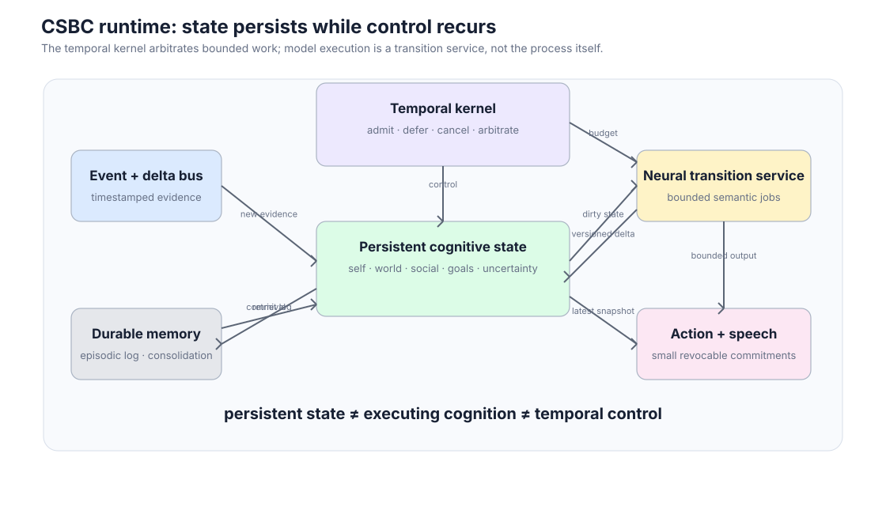
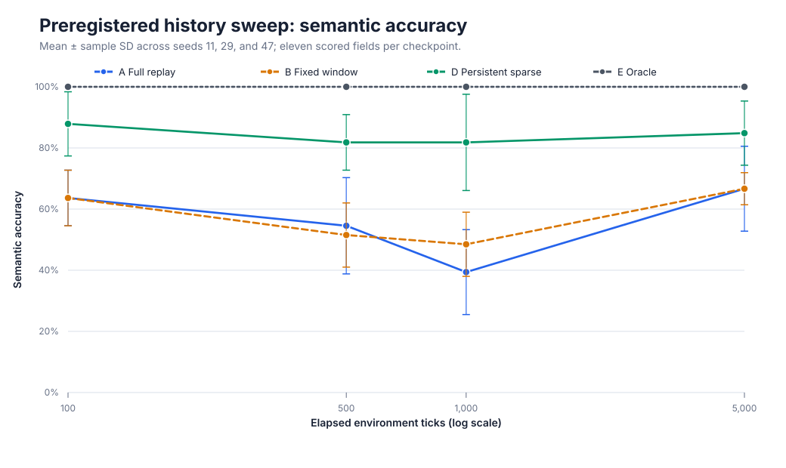
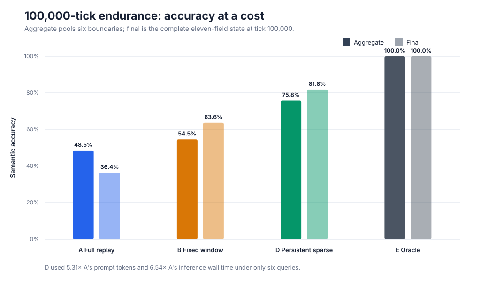
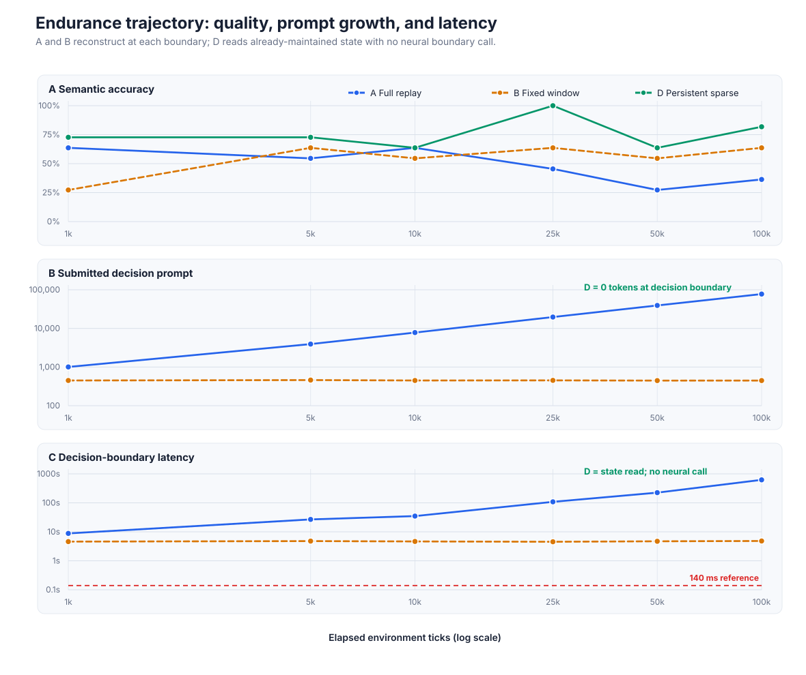
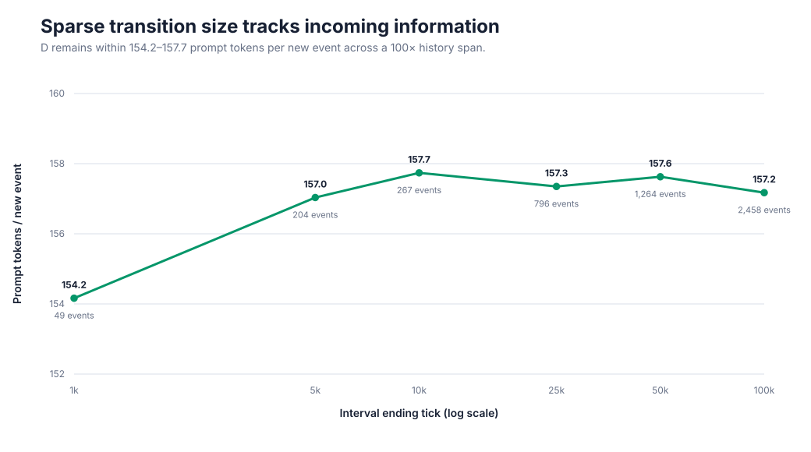
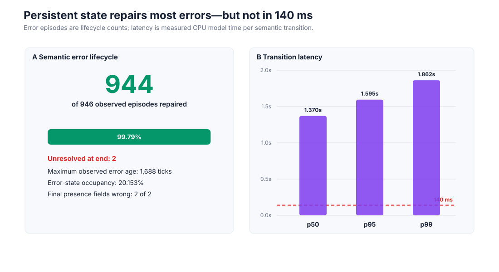
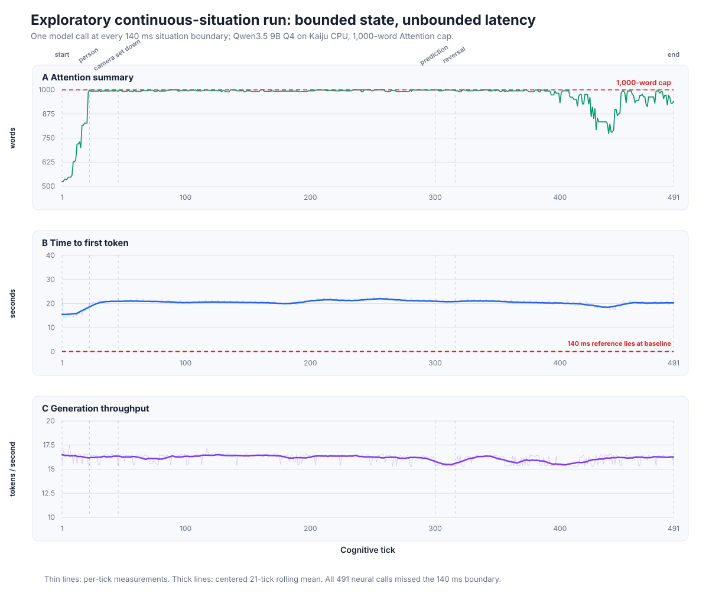

Continuous State, Bounded Computation

A Computational Architecture for Continuously Situated Artificial Cognition

Persistent Cognitive State, Intermittent Computation, and Bounded Recurrent Control

Technical working paper – conceptual and empirical revision

August 2026

Abstract

Contemporary LLM agents are usually organized around model invocations: context is assembled, a model runs, state is reconstructed implicitly, and an action is produced. That abstraction is poorly matched to a system intended to remain continuously situated in a changing world. While a long inference is running, the ordinary turn-based agent is naturally biased toward completing the episode it started; perception, speech, action, memory, and social cognition are therefore coordinated around invocation boundaries rather than around the external clock.

This paper proposes a different computational organization. A continuously situated cognitive process is modeled as persistent evolving state under bounded recurrent control, not as a sequence of completed inference episodes. The central decomposition is that persistent cognitive state, currently executing cognition, and temporal control are distinct objects. State may persist without being recomputed; cognitive work may remain unfinished across control boundaries; and action selection may repeatedly regain authority while slower neural work proceeds asynchronously. An LLM is therefore treated as a semantic state-transition operator inside a persistent process rather than as the place in which the process exists. We call this Continuous-State, Bounded-Compute cognition (CSBC).

This framing is a computational hypothesis about continuity and functional organization, not a theory of phenomenal consciousness. It is intended to supply implementable properties associated with functionally continuous cognition: persistent self/world/social state, selective access, interruptibility, explicit uncertainty, resumable thought, concurrent perception and action, and temporally bounded arbitration. Sparse updates, dynamic theory of mind, incremental speech, versioned asynchronous transactions, memory hierarchy, and performance scaling then follow as architectural consequences of the continuity requirement.

The primary empirical section evaluates the state-maintenance subset. In a preregistered three-seed history sweep, persistent sparse state reached $84.8\pm10.5\%$ semantic accuracy at 5,000 ticks versus $66.7\%$ for both full replay and a fixed ten-event window. A separate 100,000-tick endurance trajectory contained 5,038 events and six decision boundaries; persistent sparse state achieved 75.8% aggregate semantic accuracy versus 48.5% for full-history reconstruction and 54.5% for the fixed window. Sparse maintenance remained between 154.2 and 157.7 prompt tokens per new event while the final full-history decision prompt reached 77,493 tokens. The maintained condition required no neural work at the measured decision boundary, but used more total inference in this sparse-query workload, retained two final presence-state errors, and had a median semantic transition latency of 1.37 s.

A secondary exploratory run exercised personality-shaped Attention, writable self/world/social state, prediction commitments, probe answering, and bounded speech across 491 situation boundaries. It completed one model call per boundary with no model or protocol failures and answered all 18 scheduled probes, but every call missed the illustrative 140 ms deadline and the complete speech stream contained only one eight-word sentence. Together the studies support a narrow claim about persistent state, information-flux maintenance, and causal state machinery. They do not yet establish real-time semantic cognition or the stronger behavioral continuity hypothesis.

Central thesis

A continuously situated cognitive system should be modeled as a persistent, evolving state under bounded recurrent control, rather than as a sequence of completed inference episodes.

Persistent cognitive state $\neq$ currently executing cognition $\neq$ temporal control.

Introduction

Large language models are extraordinarily capable semantic processors, but their native computational abstraction is episodic: $$y_{1}=F_\theta(x_{1}).$$ A context is supplied, computation occurs, and a sequence is returned. Agent architectures add memory, tools, planning, retrieval, and environmental interaction around this interface; CoALA, for example, usefully separates memory, internal actions, external actions, and decision procedures [15]. Yet the common runtime abstraction remains approximately $$\text{construct context}\rightarrow\text{invoke model}\rightarrow\text{generate}\rightarrow\text{update external state}.$$ For bounded tasks this abstraction is effective. It becomes awkward when the intended artifact is not a task solver but an artificial cognitive process that should remain available to the world while it is already thinking, speaking, perceiving, waiting, remembering, or acting.

The motivating requirement is temporal rather than merely economic. Consider a system that is speaking while it perceives a contradictory event. If the current generation owns the process until completion, interruption must be bolted onto an architecture whose natural unit of control is still the inference episode. A continuously situated system requires the opposite ownership relation: language generation is one temporally bounded action among others, and the cognitive runtime must be able to regain control before that generation is complete.

That requirement immediately implies a persistent state. Otherwise every return of control would require reconstructing who the system is, what it currently believes, what it was doing, what other agents know, which operations remain outstanding, and what portions of prior reasoning are unfinished. The system should instead behave as a stateful dynamical process: $$X_{t+1}=U(X_t,\Delta O_t),$$ where $X_t$ already contains the currently materialized cognitive state and $\Delta O_t$ contains newly available evidence. The mathematical form is not new; recursive belief-state filtering is foundational to POMDPs and I-POMDPs [6, 3]. The conceptual claim is about what the equation means for an LLM-based cognitive runtime: the process at $t+1$ is causally descended from the process at $t$, rather than being a newly reconstructed episode that happens to receive a transcript of the past.

Architectural inversion

LLM as semantic transition operator

rather than

LLM as the location in which cognitive state exists.

This inversion is the paper’s organizing idea. Performance is important, but it is a consequence. Sparse computation is useful because persistent state should not be recomputed without cause. Incremental speech is necessary because speech must not monopolize temporal control. Asynchronous reasoning is necessary because some cognition outlives a control interval. Versioned state is necessary because old work can finish after the world has changed. Explicit uncertainty is necessary because action may occur before interpretation is complete. Dynamic theory of mind is naturally a temporal state-maintenance problem rather than a sequence of independent questions.

The paper therefore asks a narrower but more fundamental systems question than “How can an LLM agent use fewer tokens?”:

What computational organization lets an artificial cognitive process remain continuously situated in time?

The Computational Thesis: State, Execution, and Control

The three-way decomposition

Most software collapses existence and execution at an intuitive level: a component is noticed primarily when code is running. A continuous cognitive architecture cannot afford that conflation. Three quantities must be separated:

Persistent cognitive state $X_t$: the current materialized self, world, social, goal, memory, uncertainty, and process state.

Executing cognition $J_t$: the set of transitions, retrievals, planning operations, speech decodes, tool calls, or other jobs currently advancing.

Temporal control $K_t$: the mechanism that periodically regains authority to admit, suspend, cancel, continue, or arbitrate work and actions.

$\boxed{\text{persistent cognitive state};\neq;\text{executing cognition};\neq;\text{temporal control}}$

This is not a claim that these objects are independent. They are causally coupled. It is a claim that they are not identical and should not share one indivisible lifetime. State may exist for hours without being recomputed. A reasoning job may run for several control boundaries. The temporal kernel may return every 140 ms even when no semantic transition completes in that interval.

Continuous state is not continuous recomputation

Let the complete cognitive state at boundary $k$ be $$X_k={W_k,S_k,A_k,M_k,P_k,\ldots},$$ where $W_k$ is world state, $S_k$ self state, $A_k$ appraisal/attention state, $M_k$ the set of modeled entities, and $P_k$ plans and intentions. New events are $$E_k={e_1,e_2,\ldots,e_n}.$$ A dependency router determines which components could have changed: $$D_k=R(X_k,E_k).$$ For an unaffected component $x_j$, $$x_{j,k+1}=x_{j,k}.$$ For an affected component, $$x_{j,k+1}=U_j(x_{j,k},E_k,X_k).$$ The representational state therefore persists even when no computation is being spent on it. A modeled person does not require continuous neural activity merely to continue being represented. Computation is paid when new evidence, salience, dependency, uncertainty, or action relevance requires a transition.

A cognitive tick is an opportunity boundary

Suppose an implementation targets $\Delta t=140$ ms. The naive interpretation is that every cognitive subsystem must rerun every 140 ms. The proposed interpretation is that every 140 ms control returns to the runtime, which determines what should advance before the next boundary. The clock constrains control latency; it does not mandate universal semantic recomputation.

A job may be unchanged, newly runnable, awaiting information, partially completed, superseded, invalidated, sleeping, overdue, or completed. Online controller work already demonstrates fixed temporal grids that skip stale triggers when prior inference is still executing [14]. CSBC generalizes that constraint from one controller to the cognitive runtime as a whole.

Bounded progress is not bounded completion

The system requires bounded opportunities to advance work, not a guarantee that every thought completes inside one tick. A surprising social event may first set $$\texttt{belief-model-inconsistency}=\texttt{HIGH}$$ and schedule later retrieval and interpretation. The unresolved state itself is representable:

status: pending-revision
confidence: 0.31
pending_job: 9271

Action selection can proceed under uncertainty while that interpretation remains unfinished. This is a critical property of cognition in an evolving environment: incomplete cognition must not imply a frozen agent.

Functional Consciousness: Scope of the Claim

The word consciousness is easy to overclaim. CSBC does not explain why a system would have subjective experience, qualia, or “what it is like” to be that system. Nothing in the architecture or the present experiment establishes phenomenal consciousness.

The proposal is better understood as a computational hypothesis about functional continuity: an architecture capable of maintaining properties often associated with functionally conscious or access-like cognition. In this paper that operational bundle includes:

continuous temporal availability of a current self/world/social state;

selective attention and bounded broad access to relevant state;

interruption and re-arbitration while cognition or speech is underway;

explicit representation of uncertainty and incomplete cognition;

concurrent perception, thought, memory, action, and communication;

persistence of commitments and beliefs across quiescent intervals;

resumable processes whose continuation is part of current state;

a coherent causal succession from one cognitive snapshot to the next.

The hypothesis is conditional: if functional consciousness requires temporal continuity, integrated access to evolving self/world/social state, and ongoing arbitration among perception, cognition, and action, then CSBC is one implementable substrate that can be tested for those properties. It is not a metaphysical claim.

This framing also changes the empirical target. A state-first architecture should not merely be cheaper or faster. If temporal organization matters, it should behave more continuously: lower stale-action rates, faster interruption, better cross-time self-consistency, better belief continuity, more responsive speech, cleaner resumption of unfinished work, and greater action coherence under concurrent demands. The exploratory continuous-situation study later in this paper exercises only a subset of those mechanisms without a matched organizational baseline; the comparative tests remain part of the falsifiable program.

Intellectual Lineage and Novelty Boundary

Belief-state filtering and interactive state

POMDPs recursively update belief state rather than repeatedly reason from the full observation history. I-POMDPs extend the state to models of other agents and nested beliefs [6]. Their computational difficulty is also instructive: recursively representing beliefs about beliefs expands rapidly, motivating approximate filtering methods [3]. The lesson for a persistent LLM architecture is to maintain beliefs recursively while materializing higher-order recursion sparsely.

Persistent neural entity state and dynamic ToM

Recurrent Entity Networks introduced dynamic memory slots updated as new information arrives, moving world-state construction into the process of reading rather than deferring it until a question is asked [7]. ToMnet decomposes relatively stable character state from transient mental state [13]. Recent dynamic theory-of-mind work likewise treats beliefs as trajectories rather than isolated judgments [12, 2]. These lines support the idea that an entity model should evolve through time rather than be regenerated at query time.

Temporal cycles, workspaces, and online interaction

LIDA and related cognitive-cycle work provide precedent for temporally structured recurrent cognition rather than one unbounded reasoning episode [11]. Full-duplex language systems show that model behavior can be synchronized to external wall-clock chunks and that linguistic commitment can be incrementally revisited [16, 19]. Asynchronous agent work shows that tool or user latency need not halt model-side progress [8, 5]. These mechanisms are adjacent, but they do not by themselves impose the three-way separation between persistent state, currently executing cognition, and temporal authority.

What is and is not claimed as novel

The paper does not claim novelty for persistent state, ticks, event queues, sparse updates, theory of mind, incremental generation, cognitive cycles, global-workspace-style broadcast, asynchronous jobs, or schedulers. Each has substantial precedent.

The synthesis claim is narrower: once a continuously situated cognitive process is defined as persistent state under recurrent temporal control, those mechanisms become simultaneous runtime constraints rather than optional agent features. The potential contribution is therefore an ontological decomposition and systems synthesis: the process exists between model calls; model execution is one way of changing it; and temporal control repeatedly regains authority independent of whether any one semantic computation has completed.

Unified System Architecture

Figure 1 shows the resulting runtime. Persistent state is primary. Neural inference is a bounded transition service. Durable memory and background plasticity remain outside the control-critical path.

<figure>

<figcaption><strong>Figure 1.</strong> Proposed CSBC runtime. State persists independently of model execution; the temporal kernel controls when cognition may advance and action arbitration repeatedly regains authority.</figcaption>
</figure>

Temporal kernel

The temporal kernel owns monotonic time, deadlines, admission, and continuation state. Each job records at minimum: job identity, cognitive process, input state version, dependencies, earliest-run time, deadline, maximum budget, stale-after time, priority, and continuation metadata. The scheduling question is not “Which agent prompt runs next?” but “Given the latest state, deadlines, uncertainty, and compute, what cognition is worth advancing before the next control boundary?”

A practical priority hierarchy is:

corruption detection, actuator cancellation, critical interrupts;

perception synchronization, action selection, interruption, speech continuation;

appraisal, active entity ToM, working-state maintenance;

planning, episodic retrieval, explicit reasoning;

longer self-evaluation and strategy revision;

abstraction, replay, compression, training.

P0 and admitted P1 work require reserved capacity, admission control, and bounded non-neural fallbacks. Priority labels alone do not solve accelerator non-preemption or priority inversion.

Event and delta bus

Every observation enters as an immutable timestamped event $$e=(\text{type},\text{source},\text{time},\text{payload},\text{confidence}).$$ Consumers receive deltas, not reconstructed worlds. A dependency graph maps events to potentially affected state. For example, speech.user may dirty discourse state, the user model, self-appraisal, the active goal, and the speech-action selector. A false-clean field is a correctness failure; an unnecessary-dirty field is a performance cost.

Transition jobs declare semantic and control read/write sets, provenance roots, dependency versions, maximum supported fan-out, and a fallback reconstruction scope. Unknown edges, incompatible schema versions, or ambiguous latent dependencies conservatively widen the dirty set or schedule local reconstruction.

Authoritative state store

Durable cognitive state lives outside the LLM. An RDBMS is a reasonable substrate because identity, transactions, indexing, explicit relations, provenance, versioning, and temporal queries are first-class. The database need not be touched synchronously on every control tick; a hot materialized cache sits above it:

neural semantic layer
$\downarrow$
hot cognitive state
$\downarrow$
authoritative RDBMS
$\downarrow$
episodic log

The database is authoritative, hot state is latency-optimized, and the neural model is approximate. That separation permits both performance and recoverability.

Materialized Theory of Mind

For each entity $i$, maintain $$M_i=(C_i,B_i,G_i,I_i,A_i,V_i,R_i,U_i,Z_i,P_i),$$ where $C_i$ is relatively stable character state; $B_i$ epistemic state; $G_i$ goals; $I_i$ intentions; $A_i$ attention; $V_i$ affect/appraisal; $R_i$ relations; $U_i$ uncertainty; $Z_i$ an optional latent residual; and $P_i$ provenance.

Epistemic state should be typed before it is probabilistic:

subject: Alice
proposition_id: server_A_online
belief_value: true | false | unknown
provenance_root: episode_19283
status: clean | dirty | unknown

A numerical confidence is not automatically a calibrated probability; the representation must define its semantics, calibration domain, scoring rule, and update policy.

Incremental ToM updates

Suppose Alice’s current model is $M_{Alice,t}$ and a new observation arrives. Instead of supplying Alice’s entire history, the update receives $$(M^{\mathrm{relevant}}{Alice,t},\Delta O_t,W_t^{\mathrm{relevant}})$$ and produces $\Delta M{Alice,t}$, after which $$M_{Alice,t+1}=\operatorname{merge}(M_{Alice,t},\Delta M_{Alice,t}).$$ Everything not present in the delta remains unchanged. This is a temporal filtering operation rather than a regeneration of Alice as a new object.

Sparse recursive ToM

Higher-order theory of mind should be materialized only when decision-relevant. A second-order belief such as $B_{Alice}(B_{Navi}(p))$ may not exist in resident state until Alice’s behavior makes Navi’s knowledge relevant. Potential recursive state can be enormous while actual materialized recursion remains small. This is analogous to lazy allocation: reserve an addressable conceptual space without paying to instantiate it universally.

Active Entity Working Set and Shared Neural Operator

Let all known entities be $E={e_1,\ldots,e_N}$ and the active set $A_t\subseteq E$. Activation can depend on physical presence, conversation, recent mention, active plans, predicted relevance, unresolved changes, or salience. Within it, the dirty set is $D_t\subseteq A_t$. Only $D_t$ requires semantic update.

The expensive learned model should remain resident and expose isolated logical ports for ToM update, appraisal, action ranking, speech, and memory scoring. The weights are shared; the canonical transient states are not. KV caches may be retained as acceleration state but should not be the sole canonical store of beliefs, goals, or identity.

Jobs that share schemas can be microbatched. If one boundary has appraisal, two entity updates, action ranking, speech continuation, and memory scoring, six logical cognitive operations need not imply six serialized weight loads. Current serving work on PagedAttention, program-aware scheduling, and congestion-aware concurrency supplies relevant mechanisms [9, 10, 1]; a cognitive runtime adds deadlines, staleness, versions, and decision value to the scheduling contract.

Action Selection as Temporal Authority

At each control boundary the action policy receives the latest coherent snapshot: $$a_t=\pi(W_t,S_t,M_t,G_t,P_t,U_t).$$ Actions include both external and internal operations: SPEAK, MOVE, TYPE, CALL_TOOL, WAIT, RETRIEVE, THINK, INSPECT, ASK, REPLAN, and INTERRUPT. Thinking is therefore an action that competes for time rather than a privileged mode in which the rest of the agent disappears.

Speech as bounded commitment

Speech exposes the temporal issue cleanly. Suppose the agent begins, “The server looks healthy, so I think we should–” and observes a crash before the sentence completes. Ordinary streaming often chunks transport while preserving the already-selected generation episode. CSBC chunks commitment: $$a_t=\operatorname{SPEAK}(\delta y_t, b_t),$$ where $\delta y_t$ is only the fragment allowed by the current speech budget. At the next boundary, action selection runs again. It may continue, pause, backchannel, interrupt itself, change wording, stop speaking, or act concurrently. Full-duplex systems show that wall-clock language chunking is technically practical [16, 19].

Language generation no longer owns the agent’s temporal existence.

It is a bounded action issued by a process that persists before, during, and after the generation.

Asynchrony, Futures, and Snapshot Semantics

Many operations have uncertain latency: retrieval, network tools, perception, another model, file operations, or physical actions. The cognitive loop cannot block on them. An unresolved operation should itself be representable in working state. Recent asynchronous agent work demonstrates continued reasoning while tool results remain outstanding and symbolic future placeholders that allow dependency-safe progress [8, 5].

Every asynchronous update carries the snapshot version on which it was computed. A transition may include a job ID, snapshot version, read set, write set, provenance roots, deadline, staleness policy, and merge operator. At completion the runtime validates dependencies. A result commits only when its assumptions still hold, or when the field type defines a safe merge. Otherwise it is recomputed, degraded, or discarded. This prevents late cognition from silently overwriting newer cognition.

A useful implementation pattern is double-buffered state:

READ SNAPSHOT k
$\downarrow$
parallel / asynchronous updaters
$\downarrow$
proposed deltas + validators
$\downarrow$
COMMIT SNAPSHOT k+1

Memory Hierarchy and Consolidation

The architecture implies at least four memory rates:

bounded hot state needed for current control;

learned priors and optional latent residuals;

durable structured facts, relations, abstractions, and long-lived beliefs;

event history and evidence for reconstruction and provenance.

Retrieval is a value-of-information decision, not an unconditional prelude to every model call. Consolidation may reduce future retrieval and transition work, but persistent mistakes must not be laundered into model weights. Background plasticity should therefore be versioned, evaluated against new and old memory, behavior, ToM, action policy, and safety tests, and promoted only at safe boundaries. The live control loop remains operational while learning is pending.

Performance Consequences, Not the Primary Thesis

Once state persists independently of execution, several performance properties follow.

History-decoupled maintenance

Under reconstruction, approximate work can scale as $$C_{\mathrm{reconstruct}}\approx\sum_{i=1}^N C(F(H_i)),$$ where histories $H_i$ grow. Under incremental maintenance, $$C_k=C_{\mathrm{route}}+|D_k|C_{\mathrm{transition}}+C_{\mathrm{commit}}+C_{\mathrm{arbitrate}}.$$ This is conditional on bounded active-state residency, bounded dependency fan-out, bounded transition I/O, and a router that finds the causal closure or conservatively widens it. Under those conditions, $|D_k|$ can remain much smaller than the stored population.

Performance consequence

Computation should scale with relevant information flux, not with the total stored history that happens to describe the present.

This is not an unconditional asymptotic theorem. One event can invalidate a large closure, metadata can grow without bound, and accelerator, database, routing, and scheduling costs remain. Nor does persistent maintenance always use less total compute: under extremely sparse decision queries, maintaining state continuously can be more expensive than reconstructing only when asked. The benefit is primarily readiness, continuity, write isolation, and history-decoupled decision work; total-compute crossover depends on query rate.

Empirical Evaluation: Sparse Belief Ledger

The Sparse Belief Ledger experiment tests only the persistent state-maintenance subset. It does not implement the full temporal kernel, concurrent cognition, incremental speech, versioned asynchronous transactions, active-set churn, or functional-consciousness hypothesis. Its evidential role is narrow: determine whether persistent sparse state can preserve semantic continuity and decouple transition size from elapsed history in one controlled domain.

Evidence tiers and reproducibility

The evidence is reported in chronological tiers rather than pooled after development. A seed-7 development pilot established feasibility and included the missing persistent all-dirty condition C, but all development runs remain exploratory. The first confirmatory result is a protocol frozen before generation or inference: seeds 11, 29, and 47 at ticks 100, 500, 1,000, and 5,000. The 100,000-tick seed-83 endurance trajectory is a separately frozen scaling and drift study. It extends history length but is still one stochastic tape, so it does not replace the three-seed uncertainty estimate.

In that development pilot, sparse D reached 89.3% common semantic accuracy versus 53.9% for persistent all-dirty C, while using 7,529 versus 15,703 prompt tokens and 63.4 versus 177.8 s of model wall time. C's measured spurious-mutation rate was 5.8% versus zero for D. Because the prompt and stimulus were still under development, this is mechanism-discovery evidence only. It motivates repeating C under a frozen protocol; it does not remove the missing-ablation limitation from the confirmatory and endurance results.

Every plotted point is regenerated from frozen JSON or JSONL artifacts. The publication CSVs, vector figures, and renderer are stored under `experiment/results/tables`, `experiment/results/figures`, and `experiment/scripts/render_paper_figures.py`. The 491-tick continuous-situation study reported later is exploratory and is not pooled with the Sparse Belief Ledger accuracy results.

Preregistered three-seed history sweep

At tick 5,000, persistent sparse D reached $84.8\pm10.5\%$ semantic accuracy, while full replay A and fixed-window B each reached 66.7% (A: $\pm13.9$; B: $\pm5.2$ percentage points). D remained above A and B at every preregistered history boundary in the mean. The effect is not monotonic within individual seeds, and each checkpoint scores only eleven fields, so the error bars are wide.

Full replay's submitted decision prompt grew from $388\pm8$ tokens at tick 100 to $3{,}533\pm205$ at tick 5,000, a 9.11-fold increase. D's interval prompt cost remained between $157.2\pm0.9$ and $163.7\pm0.1$ tokens per new event. D performed no neural call at the evaluation boundary, but cumulative maintenance reached $35{,}719\pm2{,}158$ prompt tokens and $302.27\pm18.18$ s by tick 5,000. Under only four queries, A used $39.92\pm0.87$ s. The confirmatory result therefore supports semantic continuity, boundary readiness, and event-flux scaling—not a universal lifetime-compute reduction.

<figure>

<figcaption><strong>Figure 2.</strong> Preregistered semantic accuracy across three tapes. Error bars are sample standard deviations, not confidence intervals. D is higher in the mean at each boundary, while the small sample and eleven-field score keep uncertainty visibly large.</figcaption>
</figure>

Endurance environment and conditions

The deterministic trajectory contains 100,000 environment ticks, 5,038 events, and six evaluation boundaries. Conditions A, B, and D use the same quantized 9B model and compact protocol.

A Full replay. Reconstruct the complete semantic state at each boundary from accumulated history.

B Fixed window. Reconstruct from only the ten most recent events.

D Persistent sparse. Update semantically dirty fields as events arrive; at the decision boundary read the maintained state without a neural decision call.

E Oracle. Non-neural correctness ceiling.

A missing persistent full-state update condition remains an important ablation because it would separate persistence from sparse routing and write isolation.

Main result

Condition

Aggregate

Final

Final prompt

Final latency

Total prompt

Total wall

A Full history

48.5%

36.4%

77,493

621.73 s

149,243

1,025.53 s

B Fixed window, $K=10$

54.5%

63.6%

447

4.82 s

2,703

28.11 s

D Persistent sparse

75.8%

81.8%

0

0 neural s

792,525

6,709.86 s

E Oracle sparse reference

100.0%

100.0%

0

0

0

0

Main endurance result. Aggregate accuracy pools six evaluation boundaries; final accuracy is the complete 11-field semantic state at tick 100,000. D’s cost is maintenance over the trajectory, not decision-time inference.

D exceeded A by 27.3 percentage points and B by 21.2 points in aggregate semantic accuracy. At the final boundary, D exceeded A by 45.5 points and B by 18.2 points. The caveat is essential: D used 5.31 times A’s prompt tokens and 6.54 times A’s inference wall time because it maintained state after relevant events. This is a continuity and decision-readiness result, not a lifetime-compute win under six sparse queries.

<figure>

<figcaption><strong>Figure 3.</strong> Aggregate and final semantic accuracy by condition in the seed-83 endurance trajectory. D is higher in this seed, but the missing full-state persistence ablation prevents attribution of the gain to sparse routing alone; the annotation also preserves D's higher cumulative-maintenance cost.</figcaption>
</figure>

Checkpoint behavior

Tick

A prompt

A latency

A acc.

B prompt

B latency

B acc.

D maint. prompt

D acc.

1,000

1,006

8.81 s

63.6%

449

4.59 s

27.3%

7,554

72.7%

5,000

3,932

26.80 s

54.5%

460

4.79 s

63.6%

39,589

72.7%

10,000

7,806

34.91 s

63.6%

449

4.65 s

54.5%

81,705

63.6%

25,000

19,693

108.43 s

45.5%

452

4.54 s

63.6%

206,955

100.0%

50,000

39,313

224.85 s

27.3%

446

4.71 s

54.5%

406,195

63.6%

100,000

77,493

621.73 s

36.4%

447

4.82 s

63.6%

792,525

81.8%

Checkpoint prompts, latencies, and semantic accuracy. D’s prompt column is cumulative maintenance prompt, not decision prompt.

Full-history accuracy did not degrade monotonically with history; it fluctuated while prompt size and latency grew sharply. The defensible claim is therefore not that long context inevitably destroys accuracy. It is that reconstruction had history-dependent cost and unstable semantic results, while persistent sparse state preserved higher aggregate and final accuracy in this single trajectory.

<figure>

<figcaption><strong>Figure 4.</strong> Checkpoint behavior over the endurance trajectory. Accuracy is noisy rather than monotonically degrading. A's prompt and latency grow with history; B is bounded by construction; D pays maintenance before the boundary and therefore performs no neural decision call. Log axes prevent the late A points from hiding the early regime.</figcaption>
</figure>

The full-history server reused common prompt prefixes between checkpoints, so its wall times already benefited from prompt/KV reuse. The final request contained 77,493 prompt tokens while only 38,581 tokens required fresh evaluation. This makes raw submitted-prompt growth an imperfect proxy for actual compute and reinforces the need to report both usage and evaluated work.

Information-flux scaling

Interval ending tick

New events

D interval prompt tokens

Tokens / new event

1,000

49

7,554

154.2

5,000

204

32,035

157.0

10,000

267

42,116

157.7

25,000

796

125,250

157.3

50,000

1,264

199,240

157.6

100,000

2,458

386,330

157.2

Persistent sparse maintenance prompt tokens per new event.

D remained within 154.2–157.7 prompt tokens per new event across a 100-fold increase in elapsed tick history. A’s current decision prompt grew 77.0 times from tick 1,000 to tick 100,000, while B remained bounded at 446–460 tokens. This is the strongest support for the narrow scaling claim: sparse maintenance transition size followed event flux rather than elapsed history.

<figure>

<figcaption><strong>Figure 5.</strong> Sparse maintenance prompt tokens per new event. Point labels show the number of new events in each interval. The narrow vertical scale is deliberate: it exposes the observed 154.2–157.7-token band rather than implying zero cost.</figcaption>
</figure>

Reliability, drift, and repair

Metric

Result

Metric

Result

Model calls

4,835

Semantic error episodes

946

Failed transitions

0

Repaired episodes

944

Invariant violations

0

Unresolved at end

2

False-clean rate

0%

Repair-attempt success

93.1%

Unnecessary-dirty rate

0%

Error-state occupancy

20.153%

Spurious-mutation rate

0%

Mean observed error age

234.3 ticks

Maximum concurrent errors

7 fields

Maximum error age

1,688 ticks

Update latency p50/p95/p99

1.370 / 1.595 / 1.862 s

Persistent sparse reliability and drift metrics.

D ended with all world and belief fields correct but both presence fields incorrect. Across checkpoints, world, belief, and presence accuracies were 88.9%, 86.1%, and 25.0%, respectively. Persistent state therefore preserves both correct and incorrect state. Continuity is not correctness; repair and provenance remain core requirements.

<figure>

<figcaption><strong>Figure 6.</strong> Repair and residual drift beside transition latency. D repaired 944 of 946 observed error episodes, but two final presence errors remained. All three CPU latency quantiles were roughly an order of magnitude above the illustrative 140 ms boundary.</figcaption>
</figure>

Query-rate dependence and threats to validity

The present workload contains only six decisions, which strongly favors query-time reconstruction in total-compute accounting. At the final boundary, D’s full maintenance prompt budget equals about $792{,}525/77{,}493\approx 10.2$ final-equivalent A queries; wall time gives about $10.8$. These are illustrations, not experimental crossover points, because prompt caching, request distribution, batching, and output length matter.

The evidence remains limited by one endurance trajectory, one quantized model, eleven semantic fields, oracle-known dependency structure, a single-threaded transition path, no learned latent state, no active-set churn, no scheduler comparison, and no hard-real-time implementation. The missing persistent full-state ablation is especially important for causal attribution. The median 1.37 s semantic transition rejects any claim that this prototype itself updates semantics inside 140 ms. The 140 ms figure is a proposed control boundary for a split fast path, not a demonstrated transition latency.

Exploratory Evaluation: Continuous Situation Stream

The ledger studies measure persistent state but not the paper's motivating combination of selective Attention, evolving theory of mind, prediction, and incremental speech. A second development study therefore supplied one causal situation update every 140 ms for 491 boundaries spanning 68.73 s. The source medium was a previously recorded outdoor scene, but the subject never received frames, a source title, platform metadata, future events, or the sealed reference tape. Each tick supplied only precomputed current evidence and public questions due at that boundary. The system was framed as one cognitive transition in an ordinary social situation, not as a participant being told it was under evaluation.

Design and causal boundary

A deterministic personality-shaped Attention filter selected whole historical facts into a 1,000-word carried summary. The current tick's evidence remained a separate complete update. The model did not perform Attention and was called exactly once per tick. Writable cognition included situation, camera agency, self affect, active needs, uncertainty, an other-mind model created only when a person became identifiable, active prediction, and prediction error. Stable camera-role anchors and bounded speech and prediction ledgers prevented unsupported causal regression and unbounded transcript carry-forward. No structured serialization crossed the model boundary.

The frozen run used Qwen3.5 9B Heretic Q4_K_S on the same Kaiju CPU host. The live runner never opened the sealed oracle. After tick 491, a deterministic evaluator verified artifact hashes before opening the oracle for coverage and hard-failure checks. Model-based judging was disabled, so this study has no numerical whole-stream coherence score and no posthoc semantic probe-accuracy percentage. The aggregate metrics and frozen artifact hashes are preserved in `experiment/results/tables/visual-stream-control-core-v5.md`.

Runtime and Attention result

All 491 ticks completed with 491 model calls, zero failed calls, and zero recorded protocol violations. The Attention summary averaged 969 words, reached the 1,000-word cap, and ended at 941 words. Mean time to first token was 20.45 s (p50 20.63 s; p95 21.92 s), and client generation throughput averaged 15.71 tokens/s. No call met the 140 ms boundary. The run consumed 2,317,268 prompt tokens and 17,970 completion tokens over 11,184.88 s of model wall time. This is a successful offline causal trace and a decisive real-time failure on the measured hardware.

<figure>

<figcaption><strong>Figure 7.</strong> Per-tick telemetry for the exploratory continuous-situation run. Thin traces are raw measurements and thick traces are centered 21-tick means. Attention remained bounded, but every semantic call exceeded the 140 ms situation boundary by orders of magnitude. Milestones mark person-model creation, the unattended-camera transition, the frozen prediction, and the expectation-violating action.</figcaption>
</figure>

Behavioral audit

| Measure | Frozen result |
|---|---:|
| Scheduled probes answered at the scheduled tick | 18 / 18 |
| Deterministic hard-failure flags | 0 |
| Person model created before the identifiable-person boundary | No |
| Premature speech revealing the later reversal | No |
| Correctly uncertain first camera-operator answer | `Unknown` |
| Current operator after the camera was released | `No current operator` |
| Pre-event prediction commitment recorded | Tick 300 |
| Prediction violation explicitly recognized | Tick 316 |
| Speech actions | 1 say; 490 silence |
| Committed transcript | “He's pulling out a big plastic bag now.” |
| Motor-inhibited exact external-language echoes | 3 |

The state path captured several intended causal transitions: uncertainty about camera agency at tick 1, person-model creation at tick 23, separation of current operator from physical support and probable setup actor at ticks 46 and 58, a frozen ordinary-use prediction at tick 300, and explicit prediction error when the depicted person deliberately moved into the bag at tick 316. The deterministic audit also found no early verbal leakage of that outcome.

Those successes do not establish coherent real-time reaction. Probe coverage records that answers existed at the correct boundaries; it is not semantic accuracy. Posthoc qualitative inspection exposes overclaim and forgetting: the subject speculated about why the shirt was removed when the reason remained unknown, overstated what later brushing established about injury, and answered `Unknown` when sustained controlled motion should have ruled out a momentary accident. Most importantly, the speech system remained silent at the central reversal and produced only one earlier eight-word description. The run therefore demonstrates bounded causal state machinery and prediction lineage, while failing both the real-time compute criterion and the intended socially coherent speech outcome.

Continuity-Centered Falsifiable Program

The continuous-situation run locates two immediate failures—semantic work far outside the proposed boundary and an almost entirely silent speech channel—but it does not isolate temporal organization because it has no matched episodic condition or repeated Attention capacities. The refined thesis therefore still requires experiments that directly compare continuous behavior, not only context scaling or one architecture trace. Compare systems with roughly matched model capability under two organizational regimes:

**Episodic cognition:**reconstruct $\rightarrow$ reason $\rightarrow$ act $\rightarrow$ terminate
**Continuous cognition:**persist $\rightarrow$ update $\rightarrow$ arbitrate $\rightarrow$ continue

The crucial prediction is that the second organization should preserve coherent behavior while perception, speech, reasoning, and social-state changes overlap in time.

Primary continuity experiments

Interruption during speech. Begin an utterance, inject contradictory perception mid-utterance, and measure interruption latency, stale words emitted after contradiction, correction quality, and action latency.

Reasoning across control boundaries. Start a deliberative task that cannot finish within one boundary. Measure whether the agent remains responsive, whether unfinished work resumes without restart, and whether stale results are discarded after state changes.

Concurrent cognitive demands. Require speech, perception, planning, self-monitoring, and tool waiting to coexist. Measure action coherence, queueing, deadline misses, and whether low-priority thought blocks control-critical work.

Belief continuity after quiescence. Establish beliefs, leave them untouched across long intervals, reactivate them, and measure unnecessary mutation, forgetting, temporal attribution errors, and recovery cost.

Dynamic social knowledge. Change what another entity sees or learns while the agent is occupied with unrelated work. Measure belief-trajectory accuracy, stale-ToM actions, and higher-order belief materialization only when relevant.

Self-consistency across state transitions. Track goals, commitments, unresolved questions, and self-relevant state over long periods. Measure contradiction rate, spontaneous identity drift, and deterministic replay equality.

Dependent variables

The primary outcomes should include interruption latency, stale-action rate, environmental responsiveness during speech, ability to resume incomplete thought, self-consistency across time, belief continuity, temporal attribution error, unnecessary state mutation, action coherence under concurrent demand, deadline misses, and time-weighted state correctness. Token count and throughput remain secondary systems metrics rather than proxies for continuous cognition.

Mechanism-isolating ablations

The next round should also retain classic systems ablations:

add persistent full-state update condition C to isolate persistence from sparse routing and write isolation;

sweep decision frequency to locate the total-compute crossover among A, B, C, and D;

replicate 100k endurance across multiple seeds and models with confidence intervals and field-level breakdowns;

inject dependency faults, stale provenance, schema incompatibility, and snapshot conflicts;

scale stored population while holding active and dirty sets fixed, then sweep active set and fan-out independently;

test bounded incremental speech with cancellation and rephrasing under new evidence;

evaluate consolidation for latency and retrieval reduction without increasing drift or irrecoverable corruption.

A strong result on this program would support a substantially more interesting claim than “incremental state saves context tokens”: it would indicate that temporal organization itself contributes to behavior we identify as continuous cognition.

Failure Modes and Integrity Requirements

State drift

Persistent state can preserve errors. Every field therefore needs provenance, confidence or type-appropriate uncertainty, staleness, repair policies, and invalidation paths. Periodic reconstruction from authoritative evidence may remain useful as an integrity check. Incremental maintenance should replace routine replay, not eliminate the ability to reconstruct.

Entity identity errors and hallucinated mental states

If two entities are conflated, sparse updates can durably corrupt the wrong model. Identity resolution is therefore integrity-sensitive. Theory-of-mind fields are also hypotheses, not observations; the runtime must separate observed behavior from inferred belief, goal, affect, and speculative latent residual.

Nested-belief and hot-state explosion

Higher-order ToM must be allocated lazily. A nominally fixed set of semantic fields can still become unbounded if each field embeds growing evidence chains, message histories, or KV state. Hot state should contain bounded heads or content-addressed roots while full evidence remains durable.

Neural-state opacity and type-specific weakness

A retained KV cache can accelerate inference but should not be cognitive truth. Hybrid explicit/latent state is preferable when explicit fields support integrity and provenance while latent residuals preserve nuance. The endurance result also indicates that field types differ: world and belief state substantially outperformed presence state. Deterministic reducers may be better for simple categorical transitions, reserving neural inference for semantic ambiguity.

Consolidation corruption

Background training can turn transient mistakes into durable parametric behavior. Any plasticity path must be gated, versioned, regression-tested, reversible, and isolated from the fast control loop.

Relationship to Global-Workspace and Cognitive-Cycle Architectures

CSBC is compatible with workspace-style selection but does not depend on a philosophical claim about a global workspace. A bounded workspace can be interpreted as one resource-governance mechanism: many local state changes compete for a limited set of broadly distributed signals. LIDA provides an example of repeated cognitive cycles and temporal coordination [11]. The important distinction is that CSBC does not identify a cycle with the existence of the cognitive process. The state persists across cycles, different processes may run at different frequencies, and slow cognition can span many control opportunities.

Thus the proposed rule is not “consciousness happens every 140 ms.” It is:

The state is continuous; computation is intermittent; control is recurrent.

A representation may persist for thousands of boundaries without update. A deliberation may span twenty boundaries without blocking action. A new event can dirty only three components. Speech can be underway while another process changes the state from which subsequent speech is selected. That three-way separation is the intended difference from a simple fixed cognitive-cycle model.

Evidence Status and Hypothesis

Scientific clarity requires separating demonstrated results from the synthesis.

Established or independently demonstrated mechanisms

Prior work demonstrates recursive belief-state updating in partially observable systems; explicit models of other agents and nested beliefs; persistent neural entity-state updates; learned character and mental-state representations; dynamic belief tracking; explicit state tracking as an inference reducer; wall-clock incremental speech; asynchronous model/tool interaction; temporally structured cognitive cycles; and high-throughput multi-request serving [6, 3, 7, 13, 12, 20, 16, 19, 8, 5, 11, 9, 10].

Demonstrated in the present prototype

Within one bounded oracle-routed domain, the preregistered three-seed sweep demonstrates higher mean semantic accuracy for persistent sparse state than both reconstruction conditions at all four measured history boundaries, including $84.8\pm10.5\%$ at tick 5,000 versus 66.7% for A and B. The separate endurance trajectory demonstrates persistent snapshot state across 100,000 ticks; explicit sparse write authority with zero measured false-clean, unnecessary-dirty, or spurious-mutation events; maintenance prompt size of 154.2–157.7 tokens per incoming event; a full-history decision prompt that grew from 1,006 to 77,493 tokens; 75.8% aggregate accuracy for persistent sparse state versus 48.5% full replay and 54.5% fixed window; repair of 944 of 946 observed semantic error episodes; and zero neural work at the evaluated decision boundary after state had been maintained.

It also demonstrates limits: persistent maintenance consumed more total inference than six reconstruction queries, two final presence errors remained, and median semantic transition latency was 1.37 s.

In the separate exploratory continuous-situation domain, one bounded Attention state survived 491 future-blind updates with complete probe coverage, no hard protocol failures, correct creation and retirement of camera/person roles, and an explicit prediction-violation transition. That same run missed every 140 ms boundary and produced only one eight-word utterance, so it does not demonstrate real-time or socially coherent continuous speech.

Proposed synthesis

The full architecture combines bounded recurrent temporal control, persistent external cognitive state, event-driven dirty propagation, sparse active ToM, hybrid structured/latent representations, a shared resident semantic operator, microbatching, bounded incremental cognition and speech, action arbitration, asynchronous continuations, versioned transactions, hierarchical memory, and gated consolidation.

Hypothesis

Functional-continuity hypothesis.

If continuously situated cognition depends on a persistent causal state that remains available while perception, thought, communication, and action overlap, then an architecture of this general form should produce measurably greater temporal continuity than an episodic reconstruct–reason–act runtime at comparable model capability.

This is more specific than an AGI claim and more defensible than a phenomenal-consciousness claim. It predicts observable differences in interruption, stale action, cross-time consistency, resumption, social-state continuity, and concurrent responsiveness. Those predictions can fail even if the architecture remains useful as a systems design.

Conclusion

The deepest problem addressed by CSBC is not context-window expense. It is temporal organization. An LLM invocation is an effective computational primitive, but it is a poor candidate for the object that owns a persistent artificial mind’s existence. A system that must remain situated while it is already speaking, thinking, waiting, perceiving, or acting needs an identity and current state that outlive any particular inference episode.

The resulting architecture begins with the decomposition $$\text{persistent state}\neq\text{executing cognition}\neq\text{temporal control}$$ and the transition rule $$X_{t+1}=U(X_t,\Delta O_t).$$ From that starting point, sparse updates, materialized theory of mind, interruptible speech, resumable reasoning, explicit uncertainty, asynchronous futures, versioned commits, memory hierarchy, and bounded action arbitration are not an arbitrary checklist. They are consequences of requiring one computational process to remain causally continuous while the world changes around it.

The Sparse Belief Ledger experiments provide initial support only for the state-maintenance subset. Persistent sparse state retained a mean accuracy advantage across a preregistered three-seed short-history sweep, produced higher aggregate and final semantic accuracy in the separate endurance trajectory, kept per-event transition prompt size nearly constant with elapsed history, and eliminated neural work at the measured decision boundary. It also used substantially more total inference under six sparse queries, preserved some errors, and missed the proposed real-time semantic transition target by nearly an order of magnitude. Those limitations are part of the result.

The continuous-situation run moved closer to the motivating behavioral problem. It preserved bounded Attention, explicit uncertainty, changing camera agency, delayed person theory of mind, prediction lineage, and prediction error without future access. Yet its 20.45 s mean time to first token made a 140 ms cognitive boundary purely nominal, and its one-sentence transcript failed to provide a coherent reaction to the central surprise. Persistent state can exist without useful real-time speech; the architecture must therefore separate a fast recurrent control path from slower semantic work and must treat speech participation as a measured behavioral requirement rather than an optional by-product.

The next decisive experiments should therefore stop treating token efficiency as the central dependent variable. They should place episodic and continuous organizations under the same moving world, interrupt them mid-speech and mid-thought, change beliefs while other work is underway, force competing cognitive processes to coexist, and measure whether one architecture remains more coherent and responsive across time. If it does, the implication would be that temporal organization is not merely an optimization layer around intelligent models. It is itself a variable in the computational production of continuous cognition.

Restated in one sentence

A continuously situated artificial cognitive process should not be repeatedly recreated from its history; it should remain the same evolving process from one control boundary to the next, changing only what new information and current goals require.

References

Q. Chen et al. “CONCUR: High-Throughput Agentic Batch Inference of LLM via Congestion-Based Concurrency Control.” arXiv preprint, 2026.

R. Chen et al. “Learning Dynamic Belief Graphs for Theory-of-Mind Reasoning.” arXiv preprint, 2026.

P. Doshi and P. J. Gmytrasiewicz. “Monte Carlo Sampling Methods for Approximating Interactive POMDPs.” Journal of Artificial Intelligence Research 34, 2009.

H. Fan and Z. Lan. “From Cognitive Architectures to Language Agents: A Mechanism-Level Review of Lineage, Convergence, and Migration Gaps.” arXiv preprint, 2026.

G. Feng, H. Mao, P. Dutta, and J. E. Gonzalez. “Concurrency without Model Changes: Future-based Asynchronous Function Calling for LLMs.” arXiv preprint, 2026.

P. J. Gmytrasiewicz and P. Doshi. “A Framework for Sequential Planning in Multi-Agent Settings.” Journal of Artificial Intelligence Research 24, 2005.

M. Henaff et al. “Tracking the World State with Recurrent Entity Networks.” ICLR, 2017.

C. Hooper et al. “Building Interactive Real-Time Agents with Asynchronous I/O and Speculative Tool Calling.” arXiv preprint, 2026.

W. Kwon et al. “Efficient Memory Management for Large Language Model Serving with PagedAttention.” SOSP, 2023.

M. Luo et al. “Autellix: An Efficient Serving Engine for LLM Agents as General Programs.” arXiv preprint, 2025.

T. Madl, B. J. Baars, and S. Franklin. “The Timing of the Cognitive Cycle.” PLOS ONE 6(4), 2011.

T. N. Nguyen, D. N. Phan, and C. Gonzalez. “Dynamic Theory of Mind as a Temporal Memory Problem.” arXiv preprint, 2026.

N. C. Rabinowitz et al. “Machine Theory of Mind.” ICML, 2018.

Z. Song et al. “Learning When to Think While Listening in Large Audio-Language Models.” arXiv preprint, 2026.

T. R. Sumers et al. “Cognitive Architectures for Language Agents.” Transactions on Machine Learning Research, 2024.

B. Veluri et al. “Beyond Turn-Based Interfaces: Synchronous LLMs as Full-Duplex Dialogue Agents.” arXiv preprint, 2024.

D. Wu et al. “The Silent Thought: Modeling Internal Cognition in Full-Duplex Spoken Dialogue Models via Latent Reasoning.” arXiv preprint, 2026.

D. Zhang et al. “Useful Memories Become Faulty When Continuously Updated by LLMs.” arXiv preprint, 2026.

H. Zhang et al. “DuplexSLA: A Full-Duplex Spoken Language Model with Synchronized Speech, Language, and Action.” arXiv preprint, 2026.

W. B. Zhu et al. “PDDL-Mind: Large Language Models are Capable on Belief Reasoning with Reliable State Tracking.” arXiv preprint, 2026.
